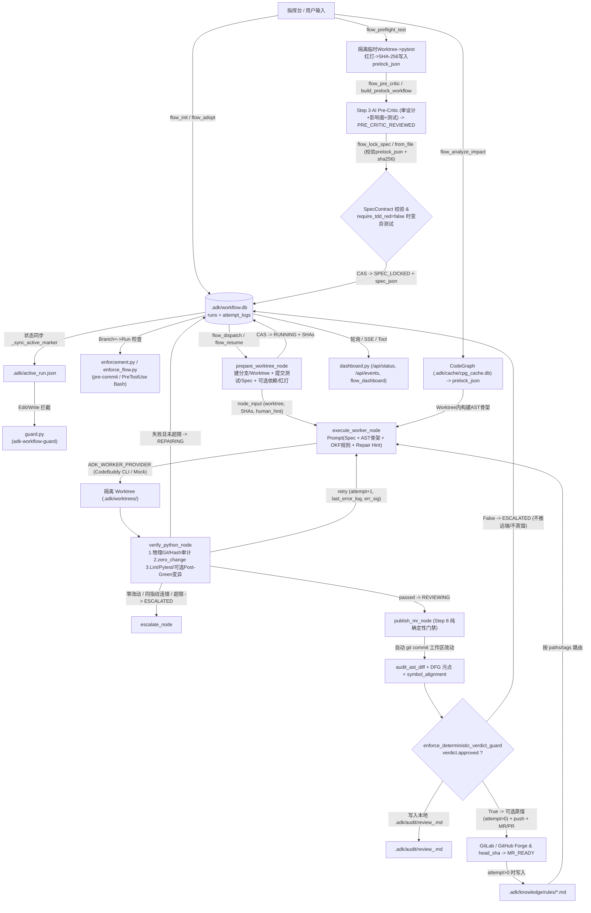

# 核心数据流与状态边界全景说明

本文档基于源码逐跳梳理 `adk-dev-flow` 的核心数据流（截至 `2026-11-28` 实测实现），覆盖状态真源、前置契约与门禁、Worktree 沙箱、验证自愈闭环、交付与知识回流、以及看板/Commit 门禁遥测。本文仅陈述当前源码中实际存在且经过核对的读写路径；已发现的边界与缺口在文末集中列出。

---

## 1. 端到端核心数据流拓扑

---

## 2. 核心数据真源（Sources of Truth）

| 存储/文件 | 写入方 | 读取方 | 承载核心字段与语义 |
|---|---|---|---|
| `.adk/workflow.db` (`runs`) | `StateStore` (`mcp_server.py`, `workflow.py`) | `mcp_server.py`, `dashboard.py`, `enforcement.py`, `okf.py` | 流水线唯一状态真源：`run_id`, `status`, `issue_iid`, `prelock_json`, `spec_json`, `branch`, `worktree_path`, `base_sha`, `head_sha`, `locked_test_sha256`, `locked_test_commit_sha`, `mr_iid`, `mr_url`, `attempt`, `last_error_sig`, `last_error_log`, `review_json`, `human_hint`, `evidence_type`, `updated_at`。 |
| `.adk/workflow.db` (`attempt_logs`) | `verify_python_node`（每轮校验通过或失败时写入） | `execute_worker_node`（fallback 读取）, `flow_status`, `publish_mr_node`（提取真实错误用于知识蒸馏） | 逐轮物理日志：`attempt`, `err_sig`, `combined_err`, `worker_summary`, `changed_files`, `created_at`。 |
| `.adk/active_run.json` | `StateStore._sync_active_marker`（每次建单或 `status` 变更自动同步） | `guard.py`, `flow_status`, `flow_unlock` | 活跃锁标记：`run_id`, `status`, `active_run_ids`, `active_runs`；无活跃状态时自动删除。 |
| `.adk/specs/issue-{iid}.md` / `task-{id6}.md` | `prepare_worktree_node` 与 `publish_mr_node`（`save_and_commit_spec_in_worktree`）；`flow_adopt_finalize`（`AdoptedSpec`） | `flow_lock_spec_from_file`, `okf.py` | OKF `DevSpec` 或 `AdoptedSpec` 规约归档，提交在目标分支中。 |
| `.adk/audit/review_{run_id}.md` | `publish_mr_node` | `okf.py` | OKF `ReviewVerdict` 审查结论及 `provenance` (`base_sha`, `locked_test_commit_sha`, `attempt`)。 |
| `.adk/cache/cpg_cache.db` | `CodeGraph`（默认路径：`{repo_or_worktree}/.adk/cache/cpg_cache.db`） | `CodeGraph.sync_git` | 按 Git Blob OID 缓存的 `FileCpg` 压缩索引（详见 `docs/cpg-cas-architecture.md`）。 |
| `.adk/knowledge/rules/*.md` | 人工维护基线规则；`publish_mr_node`（仅 `approved=True` 且 `attempt>0` 时写入 `learned_{run_id[:8]}.md`） | `execute_worker_node` (`_load_okf_rules`) | OKF `EngineeringRule`，按 `status`、`paths`、`tags` 路由注入工兵上下文。 |

---

## 3. 分阶段数据转换与约束链

### 3.1 阶段 A：建单、草拟与契约锁定（Pre-Lock）

1. **`flow_init` (`mcp_server.py`)**：
   - 在 `.adk/workflow.db` 写入 `status="SPEC_DRAFTING"`、`evidence_type="pipeline"`（此时 `branch=None`），同步 `.adk/active_run.json`。
   - 尽力安装 `.git/hooks/pre-commit`（L2 登记门禁）。
2. **`flow_analyze_impact` & `flow_preflight_test` & `flow_pre_critic` / `flow_pre_critic_from_file`（Pre-Lock 证据链与 ADK Pre-Lock 子图）**：
   - `flow_analyze_impact` 通过 `CodeGraph(root)` 计算影响面/骨架，**自动合并写入 `runs.prelock_json`**；若 `run_id` 处于 `SPEC_DRAFTING`，以 CAS 推进至 `SPEC_DESIGNED`。
   - `flow_preflight_test` 通过 `run_isolated_tdd_red_preflight` 在**隔离临时 Git Worktree**（仓库尚无 `HEAD` 提交时回退至加锁主仓；支持 `extra_dependencies` 沙盒依赖同步）执行真实红灯预检，计算 `test_sha256` 并写入 `runs.prelock_json`；同时清理陈旧 `pre_critic_report` / `prelock_error` 并允许从 `PRE_CRITIC_REVIEWED` 回退重置为 `TEST_GENERATED`。
   - `flow_pre_critic` / `flow_pre_critic_from_file`（Step 3）调用只读 `run_pre_critic_review`（`CodeBuddyLlm` + `PreCriticReport` Schema）审查设计、影响面与验收测试完整性，并绑定 `test_sha256` 与 `spec_digest` 写入 `runs.prelock_json`；通过时 CAS 推进至 `PRE_CRITIC_REVIEWED`（`highlight_critic=True`），拒绝则拦截锁定。上述 3 步亦可通过 ADK `build_prelock_workflow` / `execute_prelock_workflow` 作为整段 ADK 状态机子图执行，失败时将 `prelock_error` 写入 `prelock_json` 并在返回值包含 `error`，成功则停在 Step 4 HITL 前。
3. **`flow_lock_spec` / `flow_lock_spec_from_file` (`mcp_server.py`, `models.py`)**：
   - 自动将 `runs.prelock_json` 中的 `impact_analysis`、`red_evidence`、`pre_critic_report` 与 `design_doc` 合并入 `SpecContract`。
   - **防篡改与严格 Pre-Lock 门禁**：若存在 `red_evidence` 或已绑定哈希的 `pre_critic_report`，强制校验锁定测试与 `test_sha256`、`spec_digest` 一致（允许 OKF Markdown 末尾换行规范化）；`ADK_STRICT_PRELOCK=1`（默认）时拒绝跳过 `flow_analyze_impact -> flow_preflight_test -> flow_pre_critic` 的直跳锁定（内部测试可用 `strict_prelock=False`）。
   - `SpecContract` 静态校验：规范化路径、禁止 `..` 与受保护路径、`ast.parse` 语法检查、校验 `task.target_files` 均位于 `allowed_paths` 且不等于 `acceptance_test_path`。
   - **变异测试门禁**：`require_tdd_red=False` 时在锁前对全目标 `.py` 校验击杀率 `>= 85%`；`require_tdd_red=True` 且开启 `ADK_POST_GREEN_MUTATION=1` 时则在 `verify_python_node` 绿灯后执行确定性变异检验。
   - **OKF 解析边界**：`flow_lock_spec_from_file` 调用 `SpecContract.from_okf_markdown()`，解析 YAML Frontmatter 与正文里的 `issue_iid`、`title`、`summary`、`target_branch`、`base_branch`、`branch`、`allowed_paths`、`acceptance_test_path`、`acceptance_test_code`、`require_tdd_red`、`require_mutation_gate`、`spike`、`extra_dependencies`、`tasks` 与 `design_doc`（优先读 `meta.design_doc`，否则提取正文 `## Architecture Design` 区块）；前置证据字段由 `prelock_json` 自动合并。
   - CAS 推进至 `SPEC_LOCKED` 并将完整 `spec.model_dump_json()` 写入 `runs.spec_json`。

### 3.2 阶段 B：沙箱搭建与锁定基线（`prepare_worktree_node`）

1. 计算开发分支名：优先沿用 `runs.branch` 或 `spec.branch`，否则按 `ADK_BRANCH_PATTERN` 或默认 `adk/issue-{iid or 'task'}-{run_id[:6]}` 生成；worktree 路径为 `.adk/worktrees/{run_id}`。
2. 首次建 Worktree 时：
   - 基准分支取 `spec.base_branch or spec.target_branch`。仅当 `spec.base_branch` 显式指定且不存在时报错中止；未指定 `base_branch` 且 `target_branch` 建树失败时，先以 `git show-ref --verify --quiet refs/heads/<branch>` 探测同名残余分支，存在则直接挂载，否则从 `HEAD` 创建分支。
   - 记录写测试之前的 `base_sha`。
   - 写入 `acceptance_test_path` 并计算 `locked_test_sha256`，提交验收测试，再调用 `save_and_commit_spec_in_worktree` 提交 `.adk/specs/`，随后记录 **`locked_test_commit_sha`**（工兵真实变更的起点基线）。
   - 若指定 `extra_dependencies`，在 worktree/主仓虚拟环境安装；若 `require_tdd_red=True` 且 `ADK_SKIP_TDD_RED != "1"`，在基线 worktree 再执行一次 `run_tdd_red_preflight`。
3. Resume 恢复路径（Worktree 已存在）：执行 `sanitize_worktree_state` 清理残留 `index.lock`，保留并按需回填缺失的 `base_sha`、`locked_test_sha256` 与 `locked_test_commit_sha`（检索 `docs(spec): append OKF specification` 或 `test: lock acceptance test` 提交），将 `attempt` 重置为 `0` 并消费一次 `human_hint`。

### 3.3 阶段 C：工兵上下文注入与隔离执行（`execute_worker_node`）

工兵 Prompt 由以下数据源拼装：
1. `spec.tasks`、`allowed_paths`、`acceptance_test_path`；
2. 若 `attempt == 0 and human_hint`：注入 `human_hint` 与最近 `last_error_log[-2000:]` 并标记 `REPAIRING`（消费后清空 `human_hint`）；
3. 若 `attempt > 0`：注入 `last_error_log[-3000:]` 与 `Repair Hint`（读取 `node_input["worker_summary"]` / `worker_changed_files`，缺失时从 `attempt_logs` 最新记录读取；`verify_python_node` 在前序失败时会优先把物理审计得到的 `audit.touched_files` 回写至 `node_input["worker_changed_files"]` 与 `attempt_logs.changed_files`，不因工兵返回非 JSON 纯文本而丢失改动记录）；
4. 若有 `spec.design_doc` 则追加架构设计正文；
5. `_build_ast_context(worktree, spec.allowed_paths)`：在 `worktree` 内实例化 `CodeGraph(worktree)` 并输出目标骨架与直接调用方签名；
6. `_load_okf_rules(worktree, repo_root, allowed_paths=spec.allowed_paths)`：从 `.adk/knowledge/rules/*.md` 过滤并注入匹配规则（未传入 `tags` 时，仅声明 `tags` 而无 `paths` 的规则会被跳过）。

执行隔离（`codebuddy_bridge.py` + `guard.py`）：
- 注入 `ADK_WORKER_TOKEN=run_id`、`ADK_ALLOWED_PATHS`、`ADK_LOCKED_TESTS`、`CODEBUDDY_IS_SANDBOX=1`；
- 移除父进程 `PORT` / `CODEBUDDY_PORT` 并强制 `--port 0`；
- 将 `PYTHONPATH` 置为 `worktree/src`（及 `worktree`）优先于主仓；
- Windows 下默认 `CODEBUDDY_USE_STDIN=true` 通过 stdin 传 Prompt；`spec.spike=True` 时 `max_turns = max(60, base * 4)` 且超时翻倍。

### 3.4 阶段 D：物理审计、真机验证与熔断决策（`verify_python_node`）

1. **物理沙箱与防篡改审计（`audit_worktree_changes`）**：
   - 校验 `acceptance_test_path` 存在且 SHA-256 等于 `locked_test_sha256`（篡改时自动从 `locked_test_commit_sha` 还原并记违规）；
   - 读取 `worktree` 真实 gitdir 下的 `info/exclude`，有非注释行即判定违规；
   - 执行 `git ls-files -v` 拦截 `h`/`s`/`S`/`m` 索引隐藏标记；
   - 汇总 `git status --porcelain -uall --ignored=matching` 与 `git diff --name-only locked_test_commit_sha..HEAD`，过滤 `_is_ephemeral_runtime_artifact`（含 `.adk/cache/`、`__pycache__`、`.pytest_cache`、`.ruff_cache`、`.mypy_cache`、`.hypothesis`、`.venv`、`venv`、`.pyc/.pyo/.pyd`、`.coverage*`），校验所有触碰文件均在 `allowed_paths` 且非 `PROTECTED_PATHS`。
2. **`zero_change` 空转检测**：对比 `(locked_test_commit_sha or base_sha)..HEAD` 与 `git status --porcelain -uall --ignored=matching` 时，同样过滤 `_is_ephemeral_runtime_artifact`（排除 `.adk/cache/cpg_cache.db`、`__pycache__`、`.pytest_cache` 等运行时产物），确保工兵未改任何有效文件时立即触发 `zero_change` 熔断。
3. **验证命令执行**：优先在 `{worktree}/.venv` ➔ `{repo_root}/.venv` ➔ `uv run --project` ➔ `PATH` 解析 `ruff`（仅当 `allowed_paths` 中存在现存路径或显式配置 `ADK_LINT_CMD` 时运行）与 `pytest`，以及可选 `ADK_REGRESSION_CMD`，子进程 `PYTHONPATH` 优先指向 worktree。
4. **日志与路由**：
   - 全绿：写入 `attempt_logs`（`worker_summary`、`worker_changed_files`），保持 `VERIFYING` 路由至 `passed -> publish_mr_node`。
   - 失败：调用 `compute_error_signature` 脱敏生成 16 位指纹并写回 `attempt_logs` 与 `runs`。触发 `zero_change`、连续两轮 `err_sig` 相同或 `next_attempt > ADK_MAX_RETRIES` 时 CAS 转 `ESCALATED` 并路由至 `escalated -> escalate_node`；否则转 `REPAIRING` 回流 `execute_worker_node`。

### 3.5 阶段 E：静态硬门禁、只读 Critic 与交付（`publish_mr_node`）

1. 自动 `git add -A -- . :(exclude).adk/cache` 并提交尚未提交的沙箱改动，随后将 `status` 转入 `REVIEWING`。
2. 对 `diff_base..HEAD`（`locked_test_commit_sha or base_sha`）中的所有变更 `.py` 文件逐个运行 `audit_ast_diff`（破坏性公共签名、语法错误、危险节点、函数/方法级 DFG 污点可达性）与 `audit_symbol_alignment`；内部异常严格 fail-closed 置 `ESCALATED`。
3. 审查裁决优先级（Step 8 纯确定性，不再调用 AI Critic）：若测试桩注入了 `node_input` 中的 `approved` 结果则先过 `enforce_deterministic_verdict_guard`；否则若存在 `ast_findings` 直接由 AST+DFG+Symbol 硬门禁一票否决；否则确定性签发 `approved=True`（AI Critic 已专职前移至 Step 3 `flow_pre_critic`）。
4. 本地落盘并按 fail-closed 要求在存在 `HEAD` 提交的仓库中提交 `.adk/audit/review_{run_id}.md`（以及尽力保存 `.adk/specs/`）。
5. **发布前安全不变量**：在检查 `if not verdict.approved` 通过前，**绝不**执行 `save_distilled_knowledge`、**绝不**执行 `git push`、**绝不**创建 MR/PR，直接转入 `ESCALATED`。
6. 仅当 `verdict.approved == True` 时：若 `attempt > 0` 则从 `attempt_logs` 提取已解决的真实失败日志蒸馏写入 `.adk/knowledge/rules/learned_{run_id[:8]}.md`；记录分支尖端 `head_sha`，当 Forge 启用时推送分支并创建/更新 PR/MR 与评审评论（若推送已成功但创建 PR/MR 抛错，保留 `head_sha` 并置为 `ESCALATED` 提示人工补建），最后 CAS 转入 `MR_READY`（供 `flow_close_issue` 做祖先合入校验）。

---

## 4. 源码核查结果与已知残留边界（2026-11-28）

以下核心优化已于 `2026-11-28` 完成 TDD 加固（见 [test_data_flow_optimizations.py](file:///d:/workspace/adk-dev-flow/tests/test_data_flow_optimizations.py)、[test_prelock_workflow_and_critic.py](file:///d:/workspace/adk-dev-flow/tests/test_prelock_workflow_and_critic.py) 与 [test_prelock_hardening_round2.py](file:///d:/workspace/adk-dev-flow/tests/test_prelock_hardening_round2.py)）：
- `verify_python_node` 的 `zero_change` 检测已过滤 `_is_ephemeral_runtime_artifact`，不受 worktree 内 `.adk/cache/cpg_cache.db` 干扰；
- `verify_python_node` 已优先将物理 `audit.touched_files` 回写至 `attempt_logs.changed_files` 与下一轮 `Repair Hint`；
- `SpecContract.to_okf_markdown` / `from_okf_markdown` 与 `okf.DevSpecMeta` 已支持 `spike`、`require_mutation_gate` 与 `design_doc` 无损往返；
- Pre-Lock 已实现 `runs.prelock_json` 证据持久化、隔离临时 Worktree 红灯预检（支持 `extra_dependencies`）、Step 3 `flow_pre_critic` / `flow_pre_critic_from_file`（绑定 `test_sha256` 与 `spec_digest`，重跑 preflight 自动作废旧审批）与 ADK 子图 `build_prelock_workflow`（向调用方传播 `error`），`flow_lock_spec` 默认强制校验 Pre-Lock 流程与 SHA-256；
- Step 8 (`publish_mr_node`) 已移除 AI Critic 阻塞、清理报告中的旧 Critic 文案，并实现 push 后 MR API 失败保留 `head_sha` 与审计文件写/提交 fail-closed 保护。

当前仍保留的边界：
1. **已核实小边界**：
   - `enforcement.py` / `enforce_flow.py` 拦截提示语写的参数名为 `flow_adopt(issue=..., branch=...)`，而 MCP 工具实际签名参数名为 `issue_iid`（`mcp_server.py:1521`）。
   - `ADK_PYTHON` 仅用于 `mutation.py` 变异沙箱，不作用于 `verify_python_node` 与 `flow_preflight_test`。
