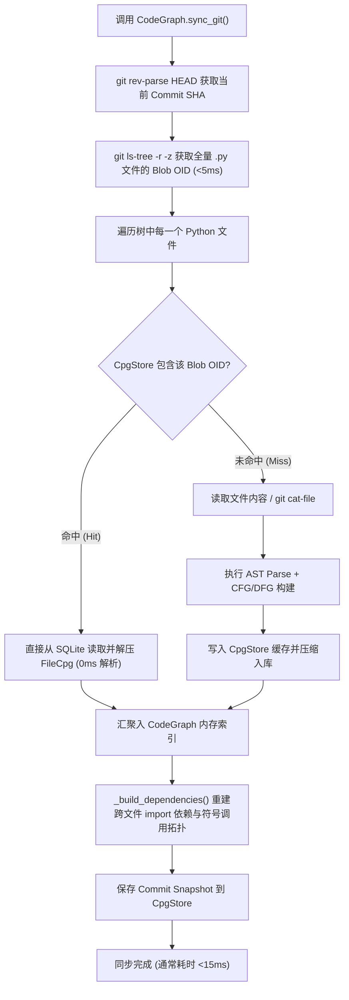

# CPG (Code Property Graph) 与 CAS 增量同步架构设计

## 1. 架构背景与设计动机

在大语言模型（LLM）驱动的软件工程（Software Engineering Agents）场景下，Agent 需要频繁理解复杂代码库的结构与调用关系。传统的静态分析方案面临两个核心痛点：

1. **AST 表达力局限**：单一 AST（抽象语法树）仅表达代码的句法嵌套与顶层声明，缺乏过程内的控制流路径（分支条件、循环跳转）与数据流传递（变量定义-使用链、参数传递与污点扩散）。这导致 Agent 在评估变更影响时，无法深入判断参数流动与分支可达性。
2. **重复解析开销与陈旧性问题**：在千级文件的中大型 Python 仓库中，全量 AST 遍历与图谱构建耗时常在数百毫秒到数秒级别。如果依赖驻留后台的 LSP 或 Watchdog 守护进程，则引入了跨平台进程泄漏与文件锁定的工程风险；如果每次无状态全量扫描，则严重拖慢流水线决策响应速度。

为此，`adk-dev-flow` 引入了 **“三图合一 CPG (Code Property Graph) + Git Blob CAS (Content-Addressable Storage) 增量同步引擎”**。

---

## 2. 三图合一数据模型 (AST + CFG + DFG)

CPG 将代码的多维属性统一收敛为标准数据模型（见 `src/adk_dev_flow/cpg.py`）：

```
┌────────────────────────────────────────────────────────┐
│                   FileCpg                              │
│                                                        │
│  ┌──────────────────┐  ┌─────────────────────────────┐ │
│  │   FileAstInfo    │  │          CfgNode            │ │
│  │                  │  │  - id: int                  │ │
│  │  - definitions   │  │  - label: str               │ │
│  │  - imports       │  │  - node_type: entry/exit... │ │
│  │  - syntax_valid  │  └──────────────┬──────────────┘ │
│  └──────────────────┘                 │                │
│                                       ▼                │
│  ┌──────────────────┐  ┌─────────────────────────────┐ │
│  │     DfgEdge      │  │          CfgEdge            │ │
│  │                  │  │                             │ │
│  │  - source_var    │  │  - source / target: int     │ │
│  │  - target_var    │  │  - kind: branch_true /      │ │
│  │  - kind: def_use │  │          branch_false /     │ │
│  │          param   │  │          loop_body / jump   │ │
│  └──────────────────┘  └─────────────────────────────┘ │
└────────────────────────────────────────────────────────┘
```

### 2.1 过程内控制流图 (Intra-procedural CFG)
- **节点类型 (`CfgNode.node_type`)**：`entry`（函数入口）、`exit`（出口）、`branch_cond`（If 条件）、`loop_cond`（For/While 条件）、`statement`（常规语句）、`return`。
- **边转移语义 (`CfgEdge.kind`)**：
  - `branch_true` / `branch_false`：If 分支的 True/False 走向；
  - `loop_body` / `loop_exit`：循环展开与跳出循环；
  - `next`：顺序前驱后继执行；
  - `jump`：Return 语句跳转至函数 Exit 节点。

### 2.2 数据流图 (Data Flow Graph, DFG)
- **边依赖语义 (`DfgEdge.kind`)**：
  - `def_use`：变量赋值到后续引用的数据传递；
  - `param_pass`：实参传递到函数/方法调用的数据传递（标记为 `call:<func>@line`）；
  - `taint_prop`：多级赋值的潜在污点传播。

---

## 3. Git Blob CAS 存储引擎 (`CpgStore`)

### 3.1 确定性内容寻址公式
CAS 彻底抛弃易失的操作系统文件修改时间（`mtime`），采用 Git 原生的 Blob Object ID 作为唯一主键：

$$\text{Blob OID} = \text{SHA-1}\left(\text{"blob "} + \text{len(bytes)} + \text{"\\0"} + \text{bytes}\right)$$

与 `git hash-object` 的输出实现 100% 字节级一致。只要文件内容不变，其 Blob OID 永恒不变；一旦内容修改，哈希即刻漂移。

### 3.2 高并发无锁 SQLite WAL 存储
存储文件位于项目本地 `.adk/cache/code_graph.sqlite`：
- **WAL 模式**：执行 `PRAGMA journal_mode = WAL;` 与 `PRAGMA synchronous = NORMAL;`，实现高并发读写与极高写入吞吐。
- **防止锁争用**：显式设置 `PRAGMA busy_timeout = 5000;`。
- **zlib 数据压缩**：将完整的 `FileCpg` 序列化为 JSON 后使用 `zlib.compress` 存入 SQLite BLOB 列，图谱体积压缩率达 70%+。
- **跨平台资源治理**：提供 `close()`、`__enter__` 与 `__exit__`，确保在 Windows 平台上安全释放文件锁句柄，彻底杜绝 `WinError 32`。

---

## 4. Git 增量同步算法 (`CodeGraph.sync_git`)

增量同步引擎通过与底层 Git 树直接对话，实现零多余解析：



### 性能基准收益
- **初次全量索引**：构建 AST + CFG + DFG 并写入 CAS 缓存；
- **后续增量同步**：只要没有提交新的 Git Blob，100% 命中缓存，耗时仅取决于 `git ls-tree`（通常 3~8ms）；
- **单文件变更**：仅针对该变更文件的单个 Blob 进行重新解析，其余百千个文件直接复用，开销几乎恒定。

---

## 5. DFG 污点追踪与安全门禁 (`audit_ast_diff`)

在流水线 Step 8（确定性硬门禁）中，除了静态 AST 破坏性变更检测（删除公共 API、移除参数等），系统利用 CPG 的 DFG 拓扑对变更代码执行污点可达性分析：

1. **污点源（Sources）**：检测进入函数的参数（`arg.arg`）与外部输入；
2. **污点流向图（Adjacency Flow）**：根据 DFG 中的 `def_use` 边构建图遍历队列；
3. **敏感下沉点（Sinks）**：监控危险调用点（`call:eval`、`call:exec`、`call:os.system`、`call:subprocess.*` 等）。

若发现外部变量通过赋值链条可达危险函数，审计器将立即阻断并生成拦截报告：
```text
发现污点变量 `req_data` 流入危险函数 `call:eval@3` (line 3)
```
大模型无法越权绕过该硬门禁。
