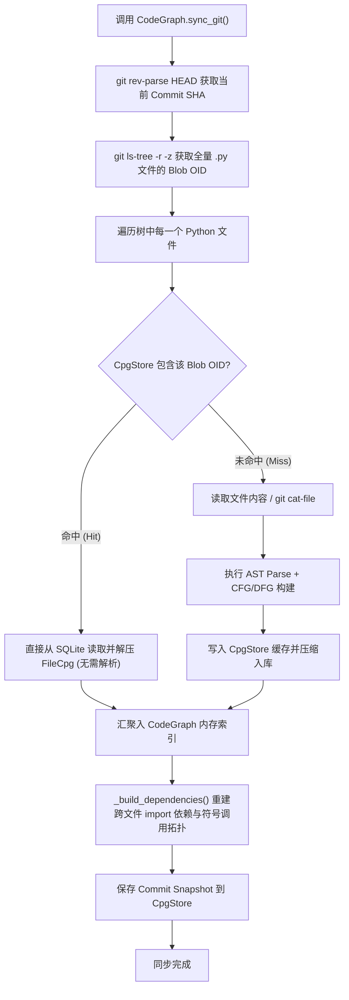

# CPG (Code Property Graph) 与 CAS 增量同步架构设计

## 1. 架构背景与设计动机

在大语言模型（LLM）驱动的软件工程（Software Engineering Agents）场景下，Agent 需要频繁理解复杂代码库的结构与调用关系。传统的静态分析方案面临两个核心痛点：

1. **AST 表达力局限**：单一 AST（抽象语法树）仅表达代码的句法嵌套与顶层声明，缺乏过程内的控制流路径（分支条件、循环跳转）与数据流传递（变量定义-使用链、参数传递与污点扩散）。这导致 Agent 在评估变更影响时，无法深入判断参数流动与分支可达性。
2. **重复解析开销与陈旧性问题**：在千级文件的中大型 Python 仓库中，全量 AST 遍历与图谱构建耗时常在数百毫秒到数秒级别。如果依赖驻留后台的 LSP 或 Watchdog 守护进程，则引入了跨平台进程泄漏与文件锁定的工程风险；如果每次无状态全量扫描，则严重拖慢流水线决策响应速度。

为此，`adk-dev-flow` 引入了 **“三图合一 CPG (Code Property Graph) + Git Blob CAS (Content-Addressable Storage) 增量同步引擎”**。

---

## 2. 三图合一数据模型 (AST + CFG + DFG)

CPG 将代码的多维属性统一收敛为标准数据模型（见 `src/adk_dev_flow/cpg.py`）：

```
┌────────────────────────────────────────────────────────┐
│                   FileCpg                              │
│                                                        │
│  ┌──────────────────┐  ┌─────────────────────────────┐ │
│  │   FileAstInfo    │  │          CfgNode            │ │
│  │                  │  │  - id: int                  │ │
│  │  - definitions   │  │  - label: str               │ │
│  │  - imports       │  │  - node_type: entry/exit... │ │
│  │  - syntax_valid  │  └──────────────┬──────────────┘ │
│  └──────────────────┘                 │                │
│                                       ▼                │
│  ┌──────────────────┐  ┌─────────────────────────────┐ │
│  │     DfgEdge      │  │          CfgEdge            │ │
│  │                  │  │                             │ │
│  │  - source_var    │  │  - source / target: int     │ │
│  │  - target_var    │  │  - kind: branch_true /      │ │
│  │  - kind: def_use │  │          branch_false /     │ │
│  │          param   │  │          loop_body / jump   │ │
│  └──────────────────┘  └─────────────────────────────┘ │
└────────────────────────────────────────────────────────┘
```

### 2.1 过程内控制流图 (Intra-procedural CFG)
- **节点类型 (`CfgNode.node_type`)**：`entry`（函数入口）、`exit`（出口）、`branch_cond`（If 条件）、`loop_cond`（For/While 条件）、`statement`（常规语句）、`return`。
- **边转移语义 (`CfgEdge.kind`)**：
  - `branch_true` / `branch_false`：If 分支的 True/False 走向；
  - `loop_body` / `loop_exit`：循环展开与跳出循环；
  - `next`：顺序前驱后继执行；
  - `jump`：Return 语句跳转至函数 Exit 节点。

构建器（`CpgBuilder._visit_stmt`）只展开 `if`、`for`/`while`、赋值和 `return`。其余语句一律压成单个 `statement` 节点并带顺序后继边，包括 `try/except`、`with`、`raise`、`break`/`continue`、`match`、嵌套函数和 lambda。模块级代码和类的方法会处理，嵌套函数体不会。

### 2.2 数据流图 (Data Flow Graph, DFG)
- **边依赖语义 (`DfgEdge.kind`)**：
  - `def_use`：变量赋值到后续引用的数据传递；
  - `param_pass`：实参传递到函数/方法调用的数据传递（标记为 `call:<func>@line`）；
  - `taint_prop`：多级赋值的潜在污点传播。

---

## 3. Git Blob CAS 存储引擎 (`CpgStore`)

### 3.1 确定性内容寻址公式
CAS 彻底抛弃易失的操作系统文件修改时间（`mtime`），采用 Git 原生的 Blob Object ID 作为唯一主键：

$$\text{Blob OID} = \text{SHA-1}\left(\text{"blob "} + \text{len(bytes)} + \text{"\\0"} + \text{bytes}\right)$$

与 `git hash-object` 的输出实现 100% 字节级一致。只要文件内容不变，其 Blob OID 永恒不变；一旦内容修改，哈希即刻漂移。

### 3.2 高并发无锁 SQLite WAL 存储
存储文件位于项目本地 `.adk/cache/code_graph.sqlite`：
- **WAL 模式**：执行 `PRAGMA journal_mode = WAL;` 与 `PRAGMA synchronous = NORMAL;`，实现高并发读写与极高写入吞吐。
- **防止锁争用**：显式设置 `PRAGMA busy_timeout = 5000;`。
- **zlib 数据压缩**：将完整的 `FileCpg` 序列化为 JSON 后使用 `zlib.compress` 存入 SQLite BLOB 列，图谱体积压缩率达 70%+。
- **跨平台资源治理**：提供 `close()`、`__enter__` 与 `__exit__`，确保在 Windows 平台上安全释放文件锁句柄，彻底杜绝 `WinError 32`。

---

## 4. Git 增量同步算法 (`CodeGraph.sync_git`)

增量同步引擎通过与底层 Git 树直接对话，实现零多余解析：



### 增量效果与调用方
- **初次全量索引**：构建 AST + CFG + DFG 并写入 CAS 缓存；
- **后续增量同步**：只要没有提交新的 Git Blob，100% 命中缓存，`parsed_files` 为 0；
- **单文件变更**：仅针对该变更文件的单个 Blob 进行重新解析，其余文件直接复用。
- **耗时**：每次同步包含 `git rev-parse` 和 `git ls-tree` 两次子进程调用；实测数字见文末核实记录。
- **调用方**：`sync_git` 目前只有测试调用。`flow_analyze_impact`、`flow_lock_spec` 的影响面反馈和派发时的上下文构建都是新建 `CodeGraph` 后直接 `analyze_impact`，走不带存储的全量 `index_repo()`。

---

## 5. DFG 污点追踪与安全门禁 (`audit_ast_diff`)

在流水线 Step 8（确定性硬门禁）中，除了静态 AST 破坏性变更检测（删除公共 API、移除参数等），系统对每个变更文件现场重建过程内 DFG（不读取已存储的图），再执行污点可达性分析：

1. **污点源（Sources）**：只有函数参数（`arg.arg`）；环境变量、文件、网络等来源不在内；
2. **污点流向图（Adjacency Flow）**：按 `def_use` 和 `param_pass` 边构建邻接表，变量按名字连接，不区分所在函数；
3. **敏感下沉点（Sinks）**：监控危险调用点（`call:eval`、`call:exec`、`call:os.system`、`call:subprocess.*` 等）。

若发现变量通过赋值链条可达危险函数，审计器将立即阻断并生成拦截报告：
```text
检测到污点变量 `req_data` 流入危险函数 `call:eval@3` (line 3)
```

**覆盖范围（2026-11-26 实测）**：指向 sink 的 `param_pass` 边只为独立表达式语句生成，所以污点检查只在 `os.system(p)` 这类写法上触发。
- 检不出：`return eval(p)`、`q = eval(p)`、赋值在 `try` 块内、经辅助函数间接到达。
- 会误报：两个无关函数有同名参数。
- sink 是 `eval`、`exec`、`os.system` 等直接调用时，前一步的危险调用检查无论什么写法都会拦截；污点检查在这类样本上没有带来额外检出。
- 分析过程抛出的异常被忽略，不会产生拦截结论。
- 现有测试 `test_taint_data_flow_reachability` 断言的是危险调用检查的结论，不覆盖以上边界。

---

## 6. 现状与边界（2026-11-26 实测）

| 层 | 构建情况 | 读取方 |
|---|---|---|
| AST 符号表（定义、导入、调用名） | `index_repo` / `sync_git` 构建 | 影响面分析、骨架生成、调用方签名；流水线在用 |
| 过程内 CFG | 随 `FileCpg` 构建并入库 | 无 |
| 过程内 DFG | 同上 | 只有第 5 节的污点检查，而且是现场重建；`CodeGraph.trace_data_flow` 没有调用方 |
| CAS 存储与提交快照 | `sync_git` 使用 | 只有测试 |
| 跨文件边表（`CpgStore.put_edges` / `get_edges`） | 有实现 | 无 |

其他边界：

- **影响面是文件级**：按导入关系取一跳和两跳的依赖方。本仓库改 `mutation.py` 会报出 15 个测试文件，其中提到它的只有 1 个。
- **符号表以裸名做键**：本仓库 65 个 `.py` 文件的 241 个顶层名里有 10 个重名，后扫描的文件覆盖先扫描的。例如 `cli_main` 只指向 `plugin_builder.py`，`ast_graph.py` 里的同名函数会丢。
- **只收 `.py`**：`mod/` 下的 TypeScript、JavaScript 和看板 HTML 既不在图里，也不在门禁里。
- **没有跨函数的边**：CFG 和 DFG 都止于函数边界，调用关系只有符号名级的 `reverse_symbol_calls`。

---

## 核实记录

2026-11-26 对照源码与实测核对：第 2 节的节点类型、边类型、类名和被压平的语句类型、第 3 节的三条 PRAGMA 与 zlib 压缩、第 5 节的 sink 列表与拦截文案，与 `src/adk_dev_flow/cpg.py`、`src/adk_dev_flow/ast_graph.py` 一致。存储路径 `.adk/cache/code_graph.sqlite` 见 `ast_graph.py:632-634`。

第 4 节的实测（Windows，本仓库 65 个 `.py`）：不带存储的全量 `index_repo()` 约 0.6 秒；带 CAS 存储的 `sync_git` 在缓存全命中时 `parsed_files` 为 0，一次约 0.36 秒（三次测量 359 到 363 毫秒）。原文的「<15ms」和「3~8ms」没有复现，已从正文移除。第 3 节的压缩率 70%+ 未复核。
